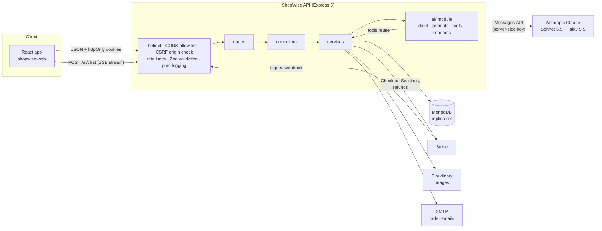
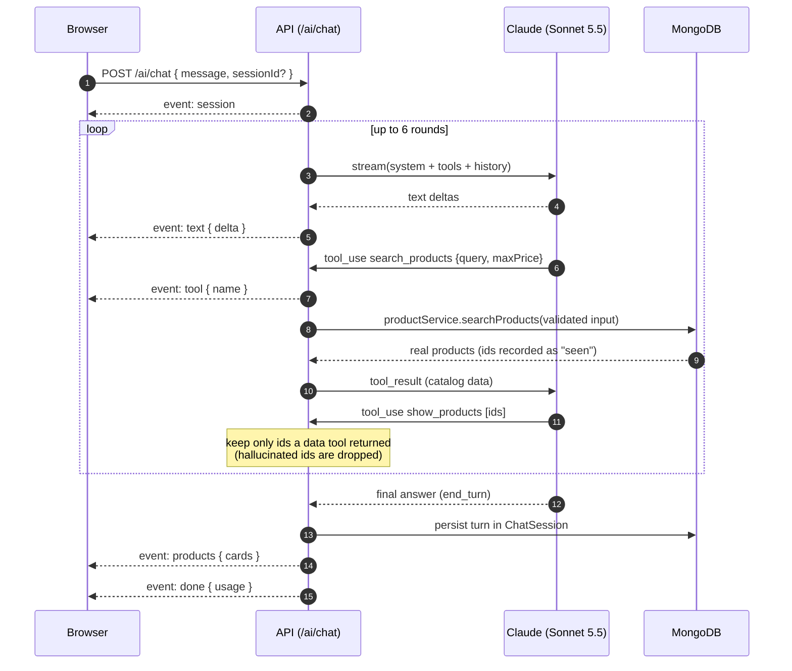

# ShopWise API

**The backend of an AI-powered e-commerce platform.** A Node.js + Express + MongoDB REST API with
real payments (Stripe), a streaming AI shopping assistant that calls tools against the live
catalog, natural-language search, AI review summaries and personalized recommendations, all
built so the shop keeps working when the AI doesn't.

[](https://github.com/<your-username>/shopwise-api/actions/workflows/ci.yml)


|                      |                                                                                                                            |
| -------------------- | -------------------------------------------------------------------------------------------------------------------------- |
| **Live API**         | `https://<your-service>.onrender.com` _(placeholder)_                                                                      |
| **Interactive docs** | `https://<your-service>.onrender.com/api/docs` _(placeholder)_                                                             |
| **Frontend**         | [shopwise-web](https://github.com/<your-username>/shopwise-web) · live at `https://<your-app>.vercel.app` _(placeholders)_ |
| **API contract**     | [API.md](./API.md)                                                                                                         |

**Demo accounts** (created by `npm run seed`):

| Role     | Email                | Password      |
| -------- | -------------------- | ------------- |
| Admin    | `admin@shopwise.dev` | `Admin@12345` |
| Customer | `demo@shopwise.dev`  | `Demo@12345`  |

Stripe test card: `4242 4242 4242 4242`, any future date, any CVC. Coupons: `WELCOME10`, `SAVE20`.

---

## Highlights

- **AI shopping assistant over Server-Sent Events.** Claude streams answers token by token while
  calling `search_products`, `get_product_details`, `compare_products` and `check_stock` against
  MongoDB. It can only display products that those tools actually returned.
- **Natural-language search.** _"waterproof running shoes under $100 with good reviews"_ becomes
  validated filters and then an ordinary indexed query, with removable filter chips.
- **AI review summaries, product copy and recommendations,** each with caching, a cost ceiling and
  a non-AI fallback.
- **Payments done properly.** Stripe Checkout, server-side price recomputation, and a
  signature-verified, **exactly-once** webhook that is the only code allowed to mark orders paid
  and decrement stock.
- **Secure auth.** httpOnly cookies, 15-minute JWTs, and **rotating refresh tokens with reuse
  detection**.
- **Quality bar.** 166 tests (Vitest + Supertest on an in-memory MongoDB replica set) at about 90%
  coverage, a test that fails CI if any endpoint is missing from the OpenAPI docs, ESLint and
  Prettier, a Docker image, GitHub Actions, and a [written security review](./docs/SECURITY.md).

---

## Architecture



**Layering:** `routes → validate (Zod) → controllers → services → models`. Services never touch
`req`/`res`, so the AI tools call the same `productService.searchProducts()` as the REST
endpoint, and the assistant can never see data the API itself wouldn't return.

```
src/
├── ai/            client.js (the only file that uses the SDK), prompts/, tools/, services/, schemas.js
├── config/        Zod-validated env (fails fast), db, logger, Stripe, catalog & commerce rules
├── controllers/   thin request/response handlers
├── docs/          OpenAPI definition + per-resource path docs (served at /api/docs)
├── middleware/    auth, requireRole, validate, rate limits, CSRF origin check, error handler
├── models/        Mongoose schemas and indexes
├── routes/        route definitions only
├── services/      business logic (no Express objects)
├── utils/         AppError, pagination, SSE, cookies, money
├── validators/    Zod request schemas
└── scripts/       deterministic seed (48 products, 228 reviews, 90 days of orders)
tests/             unit + integration tests, fake Anthropic client, Stripe signing helpers
```

---

## AI features

Every AI call goes through `src/ai/client.js`. It owns the single Anthropic client, enforces a
timeout per call, logs token usage per request (`feature`, `model`, input/output/cache tokens,
latency), handles refusals, and turns _any_ failure into one `AIUnavailableError` that each
feature catches to fall back.

| Feature                 | Endpoint                              | Model                  | How it stays cheap and safe                                                                                                            | Fallback                                                  |
| ----------------------- | ------------------------------------- | ---------------------- | -------------------------------------------------------------------------------------------------------------------------------------- | --------------------------------------------------------- |
| Shopping assistant      | `POST /ai/chat` (SSE)                 | Sonnet 5.5, low effort | Prompt-cached system prompt and tools, ≤ 6 tool rounds, 1,024 tokens per round, 90 s ceiling, aborts on client disconnect, 10 msgs/min | `error` event, a fallback reply and top-rated products    |
| Natural-language search | `POST /ai/search`                     | Haiku 5.5              | One strict tool call, 512 max tokens, 8 s timeout, 200-char queries                                                                    | Plain text search                                         |
| Review summaries        | `GET /products/:id/review-summary`    | Haiku 5.5              | ≥ 3 reviews; cached on the product, regenerated only if reviews changed **and** cache > 24 h; concurrent requests coalesced            | Stale cache, or the card is hidden                        |
| Product copy generator  | `POST /ai/admin/generate-description` | Sonnet 5.5             | Admin only, structured output validated by Zod                                                                                         | 503 (the form keeps working)                              |
| Recommendations         | `GET /ai/recommendations`             | Haiku 5.5              | Ranks ≤ 30 pre-filtered candidates, cached per user for 1 h in MongoDB                                                                 | Candidates sorted by rating; top-rated for guests (no AI) |

All prompts are template functions in `src/ai/prompts/`. User-written text (reviews, queries)
is wrapped in tags and labelled as data. `AI_ENABLED=false` turns every feature off without a
deploy.

### How the assistant's tool use works



---

## Tech stack

| Tech                                                  | Why                                                                                                                                |
| ----------------------------------------------------- | ---------------------------------------------------------------------------------------------------------------------------------- |
| **Node.js 24 + Express 5**                            | Express 5 forwards async errors to the error handler natively, so there are no `asyncHandler` wrappers.                            |
| **MongoDB + Mongoose 9**                              | Flexible product documents and an aggregation pipeline for analytics; a replica set gives the webhook multi-document transactions. |
| **Zod 4**                                             | One library validates env vars, requests, AI tool inputs and AI outputs.                                                           |
| **JWT + bcrypt + httpOnly cookies**                   | Tokens are unreachable from JavaScript (XSS), short-lived, and refreshable without re-login.                                       |
| **Stripe Checkout**                                   | PCI scope stays with Stripe; webhooks provide reliable, async-safe fulfilment.                                                     |
| **Anthropic SDK (Claude Sonnet 5.5 / Haiku 5.5)**     | Tool use, streaming and structured outputs. The fast model handles cheap tasks and the main model the conversation.                |
| **Cloudinary + multer**                               | Images stream from memory to a CDN with on-the-fly resizing and no disk writes.                                                    |
| **Nodemailer**                                        | Any SMTP provider; logs emails locally when SMTP isn't configured.                                                                 |
| **pino + pino-http**                                  | Structured JSON logs with request ids and secret redaction.                                                                        |
| **helmet, cors, express-rate-limit**                  | Security headers, an exact-origin allow-list, and per-feature throttling.                                                          |
| **swagger-jsdoc + swagger-ui-express**                | Interactive OpenAPI docs at `/api/docs`.                                                                                           |
| **Vitest + Supertest + mongodb-memory-server**        | Fast, isolated integration tests against a real MongoDB engine with no Docker needed.                                              |
| **ESLint + Prettier, Docker, GitHub Actions, Render** | Consistent code, a reproducible image, and CI on every push.                                                                       |

---

## Getting started

**Prerequisites:** Node.js 24 (see `.nvmrc`), and MongoDB as a replica set (`docker compose`
provides one, or use a free MongoDB Atlas cluster).

```bash
git clone https://github.com/<your-username>/shopwise-api.git
cd shopwise-api
npm install
cp .env.example .env          # then fill in the values (see below)

docker compose up -d mongo    # local MongoDB replica set on :27017
npm run seed                  # demo users, 48 products, reviews, coupons, 90 days of orders
npm run dev                   # http://localhost:5000  ·  docs at /api/docs
```

Local Stripe webhooks: `stripe listen --forward-to localhost:5000/api/v1/webhooks/stripe` and put
the printed `whsec_...` in `.env`. The API starts without Stripe, Cloudinary, SMTP or Anthropic
keys: those features answer with a clear "not configured" error, or a non-AI fallback, until the
keys are set.

Deployment to Render + Atlas: see [docs/DEPLOYMENT.md](./docs/DEPLOYMENT.md).

### Environment variables

Validated at startup by `src/config/env.js`. A missing or malformed value stops the server with
a list of every problem.

| Variable                                              | Required | Default                            | Purpose                                                                    |
| ----------------------------------------------------- | -------- | ---------------------------------- | -------------------------------------------------------------------------- |
| `NODE_ENV`                                            |          | `development`                      | `development` / `test` / `production`                                      |
| `PORT`                                                |          | `5000`                             | HTTP port                                                                  |
| `CLIENT_URL`                                          | ✅       |                                    | Allowed frontend origin(s), comma-separated (CORS, CSRF, Stripe redirects) |
| `MONGODB_URI`                                         | ✅       |                                    | MongoDB connection string (replica set)                                    |
| `JWT_ACCESS_SECRET`                                   | ✅       |                                    | ≥ 32 chars, signs access tokens                                            |
| `JWT_ACCESS_TTL_MINUTES`                              |          | `15`                               | Access token lifetime                                                      |
| `REFRESH_TOKEN_TTL_DAYS`                              |          | `7`                                | Refresh token lifetime                                                     |
| `COOKIE_SAMESITE`                                     |          | `lax`                              | `none` when frontend and API are on different sites (forces `Secure`)      |
| `BCRYPT_ROUNDS`                                       |          | `12`                               | Password hashing cost                                                      |
| `TRUST_PROXY`                                         |          | `0`                                | Number of proxies in front (`1` on Render)                                 |
| `LOG_LEVEL`                                           |          | by env                             | pino level                                                                 |
| `STRIPE_SECRET_KEY`                                   | prod     |                                    | Stripe test key (`rk_test_` restricted key recommended)                    |
| `STRIPE_WEBHOOK_SECRET`                               | prod     |                                    | Webhook signing secret (`whsec_...`)                                       |
| `CLOUDINARY_CLOUD_NAME` / `_API_KEY` / `_API_SECRET`  | prod     |                                    | Product image uploads                                                      |
| `SMTP_HOST` / `SMTP_PORT` / `SMTP_USER` / `SMTP_PASS` |          |                                    | Email delivery (logged when unset)                                         |
| `EMAIL_FROM`                                          |          | `ShopWise <no-reply@shopwise.dev>` | Sender address                                                             |
| `ANTHROPIC_API_KEY`                                   |          |                                    | Enables AI features (server-side only)                                     |
| `ANTHROPIC_MODEL`                                     |          | `claude-sonnet-5-5`                | Main model (chat, copywriting)                                             |
| `ANTHROPIC_FAST_MODEL`                                |          | `claude-haiku-5-5`                 | Fast model (search, summaries, recommendations)                            |
| `AI_ENABLED`                                          |          | `true`                             | Kill switch for all AI features                                            |
| `AI_REFUSAL_FALLBACK`                                 |          | `true`                             | Retry policy-declined main-model requests on Anthropic's fallback model    |

---

## Testing

```bash
npm test                 # 166 tests, ~10 s, no external services needed
npm run test:coverage    # coverage report; CI fails below the thresholds
npm run lint             # ESLint
npm run format:check     # Prettier
```

- **Real database engine, no mocks for data:** `mongodb-memory-server` runs one in-memory replica
  set for the whole run, and each test file gets its own database, so transactions, unique
  indexes, text search and TTL indexes behave exactly as in production.
- **No real API calls:** `tests/setup.js` replaces the Anthropic SDK with a scripted fake. Tests
  enqueue text, tool-use and error responses and assert on the exact request parameters.
  Stripe API calls are spied on, and webhooks are signed locally with the real Stripe signing
  algorithm.
- **What's covered:** auth flows (rotation, reuse detection, forged tokens), authorization and
  ownership, NoSQL-injection and CORS/CSRF checks, pricing math, checkout, duplicate **and
  concurrent** webhook deliveries, AI grounding (hallucinated ids are dropped), every AI fallback
  path, analytics bucketing, the seed data, and API documentation coverage.

---

## Technical challenges solved

### 1. Idempotent Stripe webhooks

Stripe delivers events _at least once_, sometimes in parallel, and a checkout can produce both
`checkout.session.completed` and `checkout.session.async_payment_succeeded`. Double-processing
would double-decrement stock.

- The webhook is the **only** code path that marks an order paid or touches stock. The admin API
  can't set `paid`, and checkout only creates a `pending` order.
- Each event id is inserted into a `ProcessedWebhookEvent` collection (unique index) **inside the
  same MongoDB transaction** as the order update, stock decrements and coupon usage. A duplicate
  hits the unique index, the transaction aborts, and nothing is applied twice. If processing
  fails, the ledger entry rolls back with it, so Stripe's retry can process the event again.
- A second _different_ event for an already-paid order is a no-op.
- Stock decrements are conditional (`{ stock: { $gte: qty } }`), so stock never goes negative.
  If it ran out between checkout and payment, the order is still recorded as paid (the money
  was taken) and flagged `needsAttention` for a refund instead of silently overselling.
- Tested with signed duplicate deliveries, three **concurrent** deliveries of one event, and
  out-of-stock races.

### 2. AI tool use grounded in real data

LLMs will happily recommend products that don't exist. The assistant can't:

- Its tools are thin wrappers over the same services as the REST API, and their inputs are
  validated with Zod as untrusted model output.
- Product cards are shown through a `show_products` tool. The server keeps a per-turn set of ids
  returned by the data tools and **drops any other id**, so a hallucinated product never
  reaches the UI.
- Natural-language search never lets the model query the database. Claude only fills a strict
  filter schema, which Zod validates and the server then runs as a normal indexed query.
- Recommendations work the same way: Claude ranks a candidate list the server built, and
  anything outside that list is discarded.

### 3. AI fallbacks and cost control

The shop must work with AI disabled, rate-limited or down:

- One `AIUnavailableError` type: timeouts, API errors, refusals, truncated or invalid output.
  Every feature catches it and returns a useful non-AI result. The chat stream sends an `error`
  event followed by a fallback reply with top-rated products.
- Cost ceilings at every layer: input length caps, `max_tokens`, per-call timeouts, a 6-round
  tool limit, per-feature rate limits keyed by user, the cheap Haiku model for high-volume tasks,
  low effort for chat, prompt caching of the static system prompt and tools, aborting the model
  call when the browser disconnects, caching (24 h review summaries with change detection,
  1 h recommendations), and request coalescing for concurrent summary requests.
- Every call logs token usage per feature, so cost per feature or user is one log query away.

### 4. Refresh token rotation with reuse detection

- Access tokens are 15-minute HS256 JWTs (algorithm, issuer and audience pinned) in an httpOnly
  cookie. Refresh tokens are random opaque strings stored **only as SHA-256 hashes**, sent in an
  httpOnly cookie scoped to `/api/v1/auth`.
- Every refresh revokes the presented token and issues a new one in the same _family_. If a
  revoked token is ever presented again, someone is replaying a stolen token, so the **whole
  family is revoked** and both the attacker and the victim must log in again.
- The claim is atomic (`findOneAndUpdate({ revokedAt: null })`), so two racing refreshes can't
  both succeed. A password change or role change revokes all of a user's sessions.

### Other details worth a look

- **Prices are never trusted:** one `priceCart()` function recomputes items, discounts, shipping
  and tax from the database for the cart preview, the saved cart and checkout. Stripe receives
  line items plus a one-off coupon, so its total exactly equals ours (and the webhook checks).
- **Documentation can't drift:** `tests/integration/docs.test.js` walks Express's router tree and
  fails if a route is undocumented or a documented route doesn't exist.
- **Defense in depth against NoSQL injection:** Zod schemas, Express's flat query parser,
  rejection of `$`/dotted keys, allow-listed filter builders, and escaped regex search.
- **Deterministic seed:** a fixed-seed PRNG produces the same 48 products, 228 reviews and 90 days
  of orders on every run, so the analytics dashboard and AI summaries have real data to show.

---

## Project docs

- [API.md](./API.md): complete contract for the frontend (endpoints, shapes, error codes, SSE format)
- [docs/SECURITY.md](./docs/SECURITY.md): security review and controls
- [docs/DEPLOYMENT.md](./docs/DEPLOYMENT.md): Render + MongoDB Atlas + Stripe webhook setup
- [CLAUDE.md](./CLAUDE.md): conventions and commands for contributors
